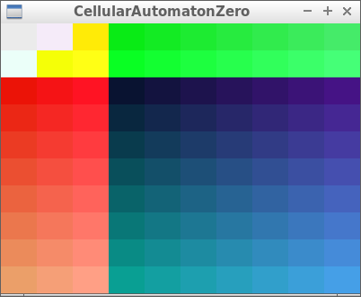

# CellularAutomatonZero

Template program for a cellular automaton in C++ and Qt.

CellularAutomatonZero is one of [Richèl Bilderbeek's tools](https://richelbilderbeek.github.io/tools/).

## Links

- [Source code](https://github.com/richelbilderbeek/CellularAutomatonZero)
- [Richèl Bilderbeek's tools](https://richelbilderbeek.github.io/tools/)
